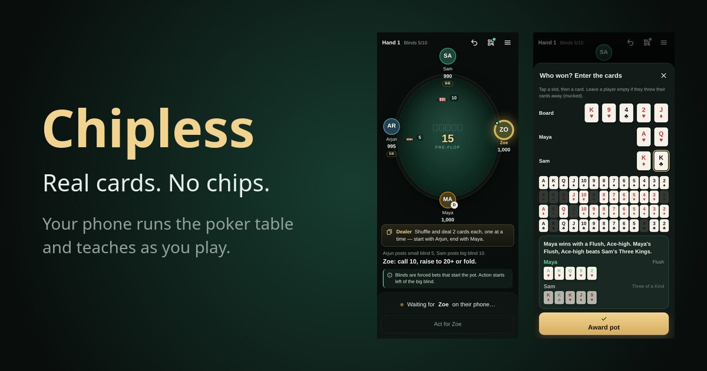
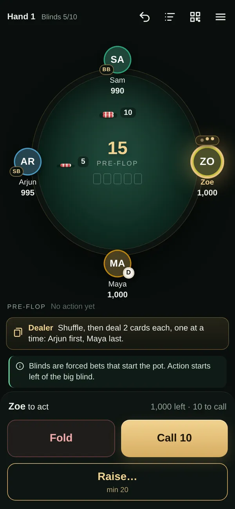
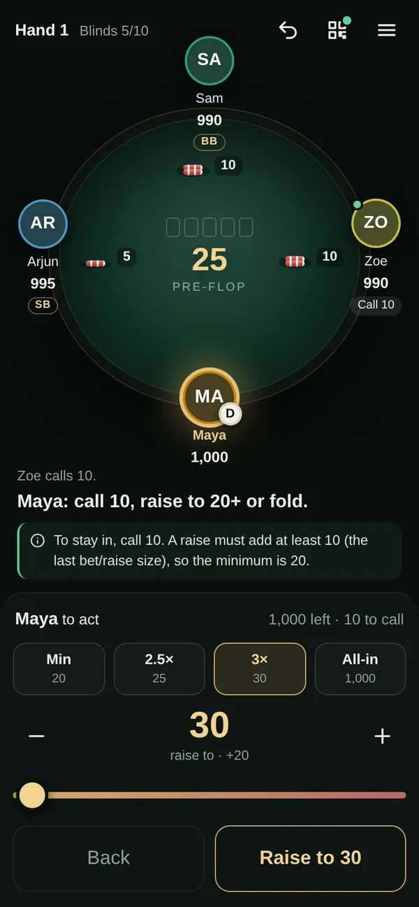
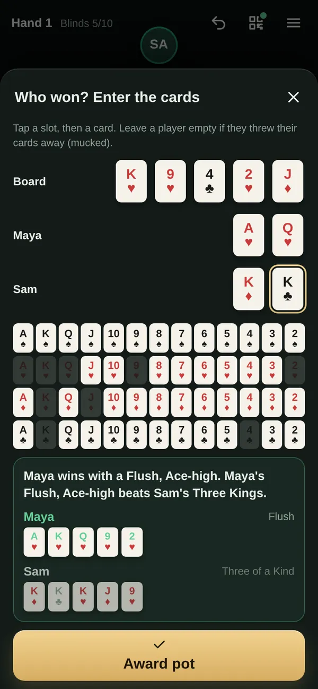
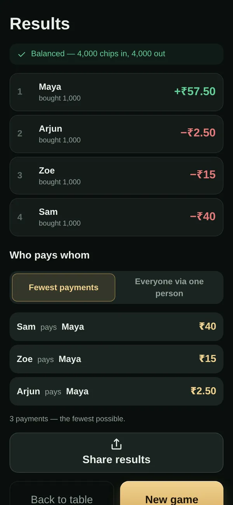

<p align="center">
  
</p>

<p align="center">
  <a href="https://github.com/sambuaneesh/chipless/releases/latest"></a>
  <a href="https://github.com/sambuaneesh/chipless/actions/workflows/ci.yml"></a>
  <a href="LICENSE"></a>
</p>

# Chipless

**Real cards. No chips.** A free, open-source **poker chips app** for Android. Chipless turns your phone into the chips, the dealer button and the rulebook for home poker. You deal real cards; the app runs every No-Limit Hold'em hand correctly, explains each rule as it comes up, and your friends play along from their own phones.

**[Website](https://sambuaneesh.github.io/chipless/)** · **[Download the APK](https://github.com/sambuaneesh/chipless/releases/latest/download/chipless.apk)** · Android 8.0+

## Install
- **Direct:** download [`chipless.apk`](https://github.com/sambuaneesh/chipless/releases/latest/download/chipless.apk) on your phone and open it. Only the host needs it; friends join from any browser.
- **With automatic updates:** add `https://github.com/sambuaneesh/chipless` to [Obtainium](https://github.com/ImranR98/Obtainium), or [open it in Obtainium directly](https://apps.obtainium.imranr.dev/redirect?r=obtainium://add/https://github.com/sambuaneesh/chipless).
- **Verify:** releases are signed with the Chipless key, certificate SHA-256 `a562dd57a4542e6eee37b12877825b42129813aa48efb8832d5a5d755c0a762f`. Builds are reproducible: building a release tag yourself gives the same APK contents.

**Free web tools** (no install): [poker hand rankings + who-wins calculator](https://sambuaneesh.github.io/chipless/poker-hand-rankings/) · [poker settle-up calculator](https://sambuaneesh.github.io/chipless/poker-settle-up-calculator/) · [how to play poker without chips](https://sambuaneesh.github.io/chipless/play-poker-without-chips/)

| | | | |
|---|---|---|---|
|  |  |  |  |

## Why it's different
- **It's the floor manager, not just a chip counter.** A narrator line says what happened and what each player can do. A dealer card spells out the physical steps ("Burn 1 · deal 3 face up: the Flop").
- **Two ways to play, in one app.**
  - **Pass this phone:** one phone in the middle of the table.
  - **Everyone uses theirs:** friends scan a QR code and play from their phone's browser. There's nothing to install, and every phone updates live.
- **Everyone sees every move.** Each bet, call and fold pops up big over the table on every phone and stays as a coloured tag on the player, with a timeline of the round. Big raises and all-ins get dramatic sounds; bets can be called out loud ("Maya raises by 300, to 400").
- **Board cards, if you want them.** The host can record the flop, turn and river as they're dealt. Every phone shows the board, and it's filled in at showdown.
- **Save, export, switch phones.** Export the night as a readable hand history, or save a backup and continue the game on another phone, even mid-hand. Drag to rearrange seats, and close the table when you're done.
- **Casino-correct rules:** blinds and button, minimum raises, short all-ins (TDA 49), side pots, uncalled bets and the odd chip.
- **Betting is tap, size, hold.** One tap to check or call, smart raise presets, and a hold for all-in. Undo replaces "are you sure?" pop-ups. Tap a greyed-out button to learn why it's disabled.
- **The Referee:** enter the cards and it names the winner, then explains why ("Maya's Flush, Ace-high beats Sam's Three Kings").
- **Settling up:** play for points, or for real buy-ins with rebuys, and finish with the fewest payments.
- **Tiny, offline and private.** The whole app is about 125 KB. No accounts, ads, analytics or cloud. Every action is saved, so a closed app picks up exactly where it was.

## Layout
| Path | What |
|---|---|
| `engine/` | Pure Kotlin rules engine, hand evaluator, settlement and coach text. Heavily unit-tested. |
| `server/` | Session (event log, protocol, persistence) and a zero-dependency HTTP + WebSocket server. Plain JVM. |
| `android/` | Thin shell: one Activity with a WebView, a foreground service while hosting, and voice/haptics/share. |
| `web/` | The table UI (TypeScript + Preact), served by the phone to itself and to friends' browsers. |
| `docs/` | [Spec](docs/spec.md), [ADRs](docs/adr/), [protocol](docs/protocol.md), [research](docs/research/). |

## Build
Requirements: JDK 21, Android SDK (platform 36, build-tools 36), Node 20+.

```bash
echo "sdk.dir=$HOME/Android/Sdk" > local.properties   # once
./gradlew :android:assembleRelease                      # builds web + APK; fails if the APK > 1 MB
adb install -r android/build/outputs/apk/release/android-release.apk
```
Without a release key, release builds are signed with the debug key so anyone can build and sideload from source. Maintainers add the release key to `~/.gradle/gradle.properties` (`CHIPLESS_STORE_FILE`, `CHIPLESS_STORE_PASSWORD`, `CHIPLESS_KEY_ALIAS`, `CHIPLESS_KEY_PASSWORD`) and publish with:

```bash
scripts/release.sh 1.0.1   # bump version, test, build, verify signature, tag, push, GitHub release
```

## Develop
```bash
./gradlew :engine:test :server:test        # 32 JVM tests (rules, evaluator, settlement, protocol)
cd web && npm ci && node build.mjs --watch # rebuild the client on change
./gradlew :server:dev                      # serve web/dist on :8737; prints HOST and GUEST URLs
node web/test/e2e.mjs <HOST url> <GUEST url> <screenshot dir>   # headless two-phone smoke test
```
Open the HOST URL in a desktop browser to act as the host phone. Open the GUEST URL on any phone on the same network.

## Website
The site lives in [`site/`](site/) and deploys to GitHub Pages on every push to `main`: the landing page plus three tool and guide pages that share `site.css` and `poker.js` (a dependency-free hand evaluator and settle-up solver mirroring the engine). `site/capture.mjs` re-records the demo video and screenshots from a real game against the dev server.

## Distribution
Store listing text, screenshots and changelogs live in [`fastlane/metadata/android/en-US/`](fastlane/metadata/android/en-US/) (used by F-Droid and IzzyOnDroid). Add `changelogs/<versionCode>.txt` before each release. See [docs/distribution.md](docs/distribution.md) for the store and launch checklist.

## License
[GPL-3.0](LICENSE). Chipless only keeps score. It doesn't handle money. Please play responsibly and within the law where you live.
